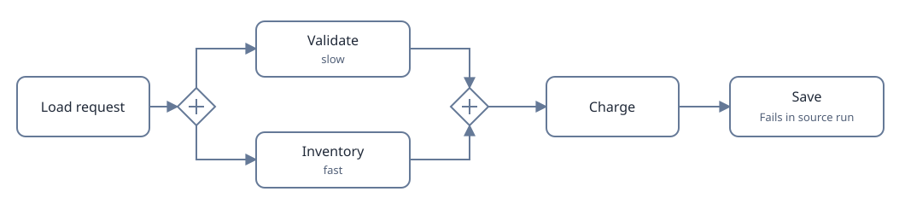

# Parallel workflow rerun

Plain Dapr Workflow + Aspire. Compare actual activity executions with Catalyst’s rerun graph.



Validate and Inventory run in parallel. Charge waits for both. Save fails in the original process and succeeds in the rerun.

## Prerequisites

- .NET 10 SDK.
- [Dapr CLI and runtime](https://docs.dapr.io/getting-started/install-dapr-cli/) supporting rerun; this sample uses Dapr .NET SDK 1.19.1.
- Local mode: Docker Desktop and `dapr init` (Redis `6379`, placement `50005`, scheduler `50006`).
- Catalyst mode: [current Diagrid CLI](https://docs.diagrid.io/getting-started/install-cli/), a Catalyst account, and `diagrid login`.
- Optional: Python 3 for verification; PowerShell 7.1+ for Catalyst setup.

## Run locally (default)

Diagrid is disabled by default (`"Enabled": false` in `AppHost/appsettings.json`). No Diagrid login or connection settings are needed for local testing. Run these commands from the repository root:

```bash
dotnet build ParallelRerunRepro.slnx
dotnet run --project AppHost --launch-profile http --no-build
```

Open the Aspire dashboard login URL printed in the terminal, then [the demo](http://localhost:5260).

1. Click **Start process** and wait for Save to fail.
2. Click **Rerun from Inventory**, or enter a listed scheduling event ID (including `0`).
3. After completion, click **Compare execution evidence**.
4. In Aspire, filter structured logs for `ACTIVITY_EXECUTED` and the rerun instance ID. Follow a trace link to see the activity span.

For the Inventory rerun, Load request is reused; Validate, Inventory, Charge, and Save execute again. Tokens generated inside activity bodies distinguish fresh executions from reused results.

## Run against Catalyst

Enable Diagrid only when you want to test against its managed workflow engine:

1. Stop the local AppHost (`Ctrl+C`). Install a [current Diagrid CLI](https://docs.diagrid.io/getting-started/install-cli/) on PATH and run `diagrid login` with your account.
2. In **`AppHost/appsettings.json`**, set `Diagrid:Enabled` to `true`.
3. Save your organization and project in **AppHost user secrets**:

```bash
dotnet user-secrets set "Diagrid:Organization" "your-organization-name-or-id" --project AppHost
dotnet user-secrets set "Diagrid:Project" "your-existing-project" --project AppHost
```

Find your organization with `diagrid org list`. Your account must have access to the project, with managed workflows enabled. In Rider, right-click the **AppHost project → Manage User Secrets** to edit these values. The `http` launch profile loads them automatically. Leave Aspire-generated entries unchanged.

Run the same build/start commands shown above, then use [the demo](http://localhost:5260). The worker and Aspire stay local; workflow execution and history use Diagrid. No API token needs to be copied.

AppHost selects the configured organization in the CLI and creates or reuses the `parallel-rerun-repro` app. A missing project can also be created. To provision one explicitly:

```powershell
pwsh ./scripts/setup-catalyst.ps1 -Organization your-org -ProjectName your-project
```

The setup script takes parameters only; it does not read appsettings or user secrets. Add `-WhatIf` to preview, `-Region` to choose a region, or `-AppId` to provision another app. For this demo, keep the default app name `parallel-rerun-repro`.

Compare Catalyst’s graph with Aspire logs and traces. Remote runtime spans depend on Diagrid’s tracing configuration. To return to local Dapr, stop AppHost, set `Diagrid:Enabled` back to `false`, and start it again.


Reported graph: Validate appears dimmed. Compare this with its actual worker invocation in Aspire.

## Verify and share evidence

With the worker running:

```bash
python3 scripts/verify.py --label local
# For Catalyst, use --label catalyst
```

Checks discover Inventory’s actual scheduling ID and verify result provenance and worker invocations. Evidence is saved under `artifacts/`. You can also download evidence from the demo or use [requests.http](requests.http).

Keep the worker running during comparison: its execution list is in memory. Download evidence before stopping Aspire with `Ctrl+C`.
