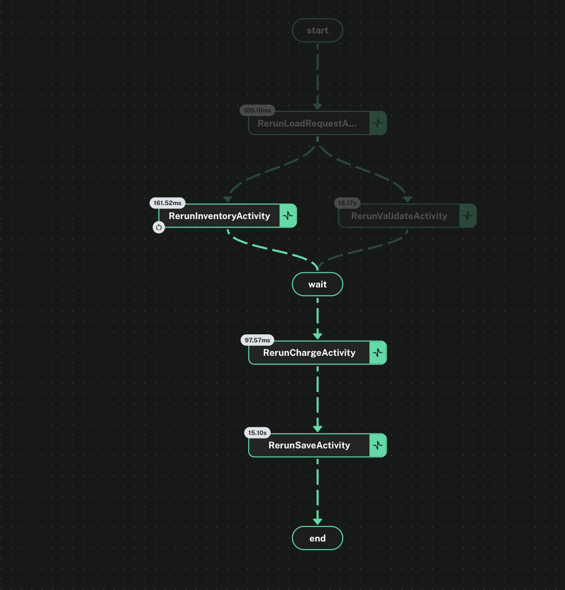

# Parallel workflow rerun

Plain Dapr Workflow + Aspire. Compare actual activity executions with Catalyst’s rerun graph.


Validate and Inventory run in parallel. Charge waits for both. Save fails in the original process and succeeds in the rerun.

## Prerequisites

- .NET 10 SDK.
- [Dapr CLI and runtime](https://docs.dapr.io/getting-started/install-dapr-cli/) supporting rerun; this sample uses Dapr .NET SDK 1.19.1.
- Local mode: Docker Desktop and `dapr init` (Redis `6379`, placement `50005`, scheduler `50006`).
- Catalyst mode: [current Diagrid CLI](https://docs.diagrid.io/getting-started/install-cli/), a Catalyst account, and `diagrid login`.
- Optional: Python 3 for verification; PowerShell 7.1+ for Catalyst setup.

## Run locally

```bash
dotnet build ParallelRerunRepro.slnx
dotnet run --project AppHost --launch-profile http --no-build
```

Open the Aspire dashboard login URL printed in the terminal, then [the demo](http://localhost:5260).

1. Click **Start process** and wait for Save to fail.
2. Click **Rerun from Inventory**, or enter a listed scheduling event ID (including `0`).
3. After completion, click **Compare execution evidence**.
4. In Aspire, filter structured logs for `ACTIVITY_EXECUTED` and the rerun instance ID. Follow a trace link to see the activity span.

For the Inventory rerun, Load request is reused; Validate, Inventory, Charge, and Save execute again. Tokens generated inside activity bodies distinguish fresh executions from reused results.

## Run against Catalyst

Stop the local AppHost first. After building and logging in:

```powershell
pwsh ./scripts/setup-catalyst.ps1
```

The script creates or reuses the `parallel-rerun-repro` project and app in your selected organization and default region. Use `-ProjectName` or `-Region` to override, or `-WhatIf` to preview.

```bash
dotnet run --project AppHost --launch-profile http --no-build -- \
  --UseCatalyst=true --CatalystProject=parallel-rerun-repro
```

Use the same demo page. Aspire runs the local worker through `diagrid dev run`, without a local sidecar. Open the rerun instance in Catalyst and compare the graph with the worker’s execution evidence. The reported case is Validate appearing dimmed despite executing again; confirm the graph behavior in Catalyst itself.



Reported graph: Validate appears dimmed. Compare this with its actual worker invocation in Aspire.

## Verify and share evidence

With the worker running:

```bash
python3 scripts/verify.py --label local
# For Catalyst, use --label catalyst
```

Checks discover Inventory’s actual scheduling ID and verify result provenance and worker invocations. Evidence is saved under `artifacts/`. You can also download evidence from the demo or use [requests.http](requests.http).

Keep the worker running during comparison: its execution list is in memory. Download evidence before stopping Aspire with `Ctrl+C`.
